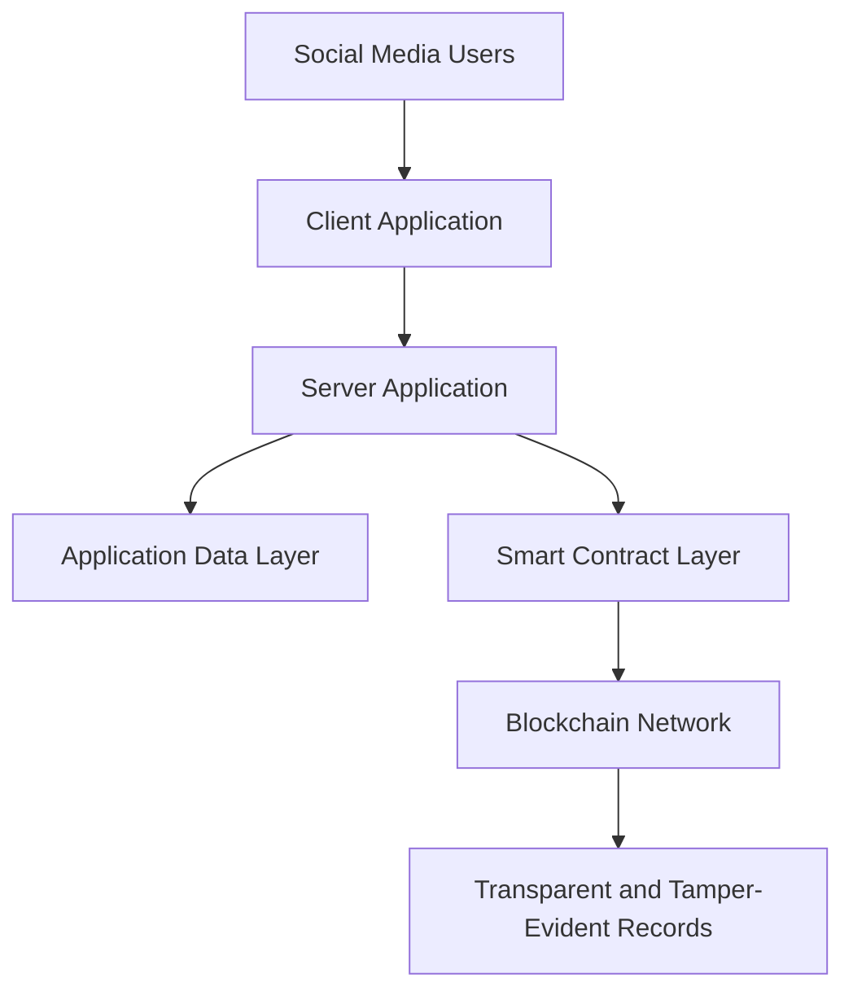

# 🔗 Blockchain-Based Social Media Platform
### Combating Online Propaganda Through Blockchain Technology

A decentralized social media platform that explores how blockchain technology can help reduce online propaganda, improve information transparency, and build trust in digital communication.

---

## 📖 Project Overview

Social media has become one of the primary sources of information in modern society. Millions of people rely on social networking platforms to receive news, share opinions, and communicate with others.

However, the rapid growth of social media has also created significant challenges, including:

- The spread of misleading information and online propaganda.
- Manipulation of public opinions through coordinated content distribution.
- Unauthorized modification or removal of published information.
- Lack of transparency in how information is managed and distributed.
- Difficulty establishing accountability for misleading or manipulated content.

Traditional centralized social media platforms have significant control over user-generated content and platform data. This can create challenges when users want transparency, accountability, and confidence in the information they consume.

To explore an alternative approach, I developed a **Blockchain-Based Social Media Application** that investigates the use of decentralized technologies to improve transparency and trust in online social interactions.

The system integrates blockchain technology and a web-based social media application to explore how information can be managed with greater transparency and accountability.

## 🎯 Project Objectives

The primary objective of this project is to explore how blockchain technology can help address the problem of online propaganda and information manipulation.

Key objectives include:

- Explore decentralized social media architecture.
- Improve transparency in social media content management.
- Use blockchain technology to maintain tamper-evident information records.
- Reduce opportunities for unnoticed manipulation of published content.
- Establish greater accountability in digital information sharing.
- Explore how decentralized applications can improve user trust.
- Demonstrate the practical integration of blockchain technology with a web application.

## 💡 Key Concept

### Why Blockchain for Social Media?

Traditional social media platforms generally rely on centralized databases controlled by individual organizations.

This means that platform operators have significant control over how content and related records are stored and managed.

Blockchain introduces a different approach through distributed, tamper-evident records.

By leveraging blockchain technology, this project explores the possibility of:

- Maintaining transparent records of relevant content-related activities.
- Making unauthorized changes to recorded information detectable.
- Improving accountability through blockchain-based transactions.
- Reducing dependence on a single centralized authority for record integrity.

The overall goal is to explore a more transparent social media environment where information-related activities can be independently verified.

## 🏗️ System Architecture

The application consists of two primary components:

1. **Client Application:** The frontend interface through which users interact with the social media platform.
2. **Server Application:** The backend component responsible for application-side processing and communication with the blockchain layer.

Solidity is used for blockchain-related smart contract development.

### High-Level Architecture



## 🔐 Role of Blockchain Technology

Blockchain is the core technology explored in this project to improve the transparency and integrity of social media information.

Unlike a conventional centralized database, blockchain provides a distributed ledger where recorded transactions can be independently verified.

Potential applications within this system include:

- **Data Integrity:** Using blockchain-based records to make unauthorized modifications detectable.
- **Transparency:** Providing a verifiable history of relevant blockchain transactions.
- **Accountability:** Creating an auditable record of information-related activities.
- **Decentralization:** Exploring alternatives to fully centralized information management.

*Note: Blockchain provides data integrity and traceability, but does not independently verify the factual accuracy of information. Additional fact-checking, moderation, and verification mechanisms are necessary to identify propaganda.*

## 🛠️ Technologies Used

| Technology | Purpose |
|---|---|
| JavaScript | Application development and client/server-side functionality |
| Solidity | Blockchain smart contract development |
| HTML5 | Web application structure |
| CSS3 | User interface styling |
| Blockchain | Decentralized and tamper-evident transaction records |

## 📂 Project Structure

```text
blockchain-based-social-media-app/
│
├── client/
│   └── Frontend application
│
├── server/
│   └── Backend application
│
└── README.md
```

## ⚙️ Application Workflow

The conceptual workflow of the platform is:

1. A user accesses the social media application through the client interface.
2. The client communicates with the server application.
3. The server handles the application's backend processing.
4. Blockchain-related operations interact with the deployed smart contracts.
5. Relevant blockchain transactions are recorded on the blockchain network.
6. Blockchain records provide a mechanism for verifying the integrity and history of recorded information.

## 🌍 Expected Impact

This project explores how decentralized technologies can contribute to a more transparent digital communication environment.

Potential benefits include:

- **Reduced Information Manipulation:** Tamper-evident records can make certain forms of unnoticed content manipulation more difficult.
- **Increased Transparency:** Blockchain transactions can provide independently verifiable records.
- **Improved Accountability:** Relevant information-related activities can have an auditable history.
- **Greater User Trust:** Transparent recordkeeping can help users better understand the history of information shared on a platform.
- **Decentralized Innovation:** Demonstrates an alternative architectural approach to traditional centralized social networking systems.

## 🚀 Future Enhancements

Potential future improvements include:

- Blockchain-based content verification.
- Community-driven fact-checking mechanisms.
- Reputation systems for information sources.
- Detection of coordinated propaganda campaigns.
- AI-assisted misinformation and propaganda detection.
- Transparent content moderation history.
- Decentralized identity and authentication.
- Integration with external fact-checking organizations.

## 🎓 Project Significance

This project was developed to investigate the application of blockchain technology to a real-world societal challenge: the spread of online propaganda and information manipulation.

It demonstrates the potential of combining web application development and smart contract technology to explore more transparent and accountable social media platforms.

Rather than relying entirely on centralized trust, the project explores how blockchain-based verification and traceability can contribute to building trust in digital information systems.

---

## 👨‍💻 Developer

**Oshan Mihiraj Wijesooriya**

Software Engineer | Blockchain Technology | Software Architecture

GitHub: [@Omihiraj](https://github.com/Omihiraj)

---

⭐ If you find this project interesting, consider giving this repository a star!

